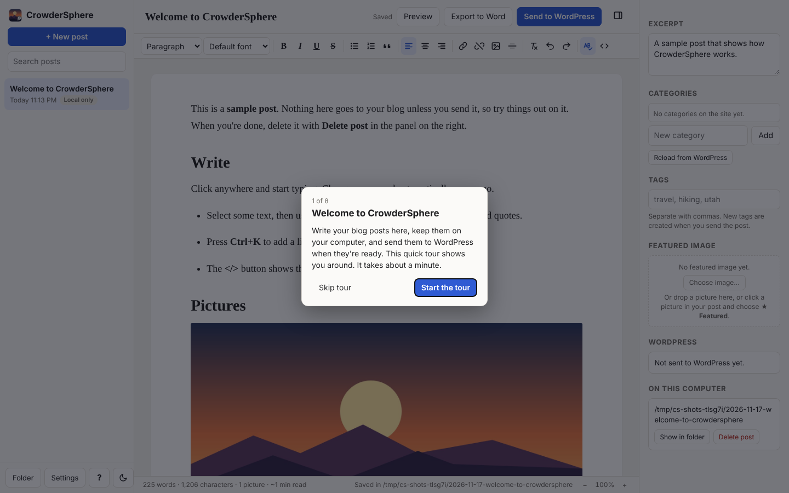
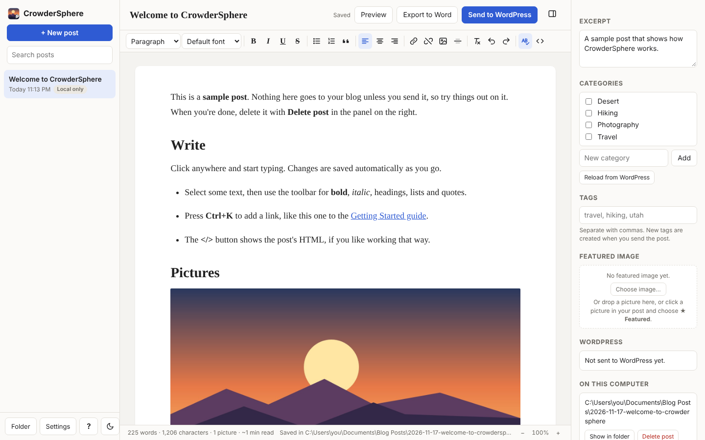
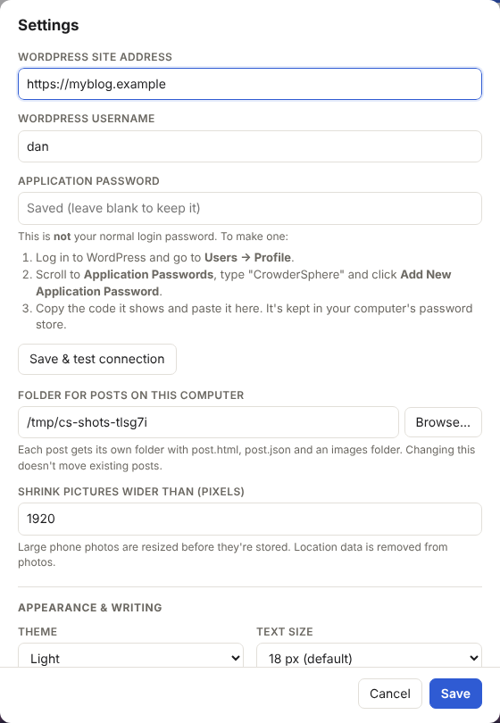
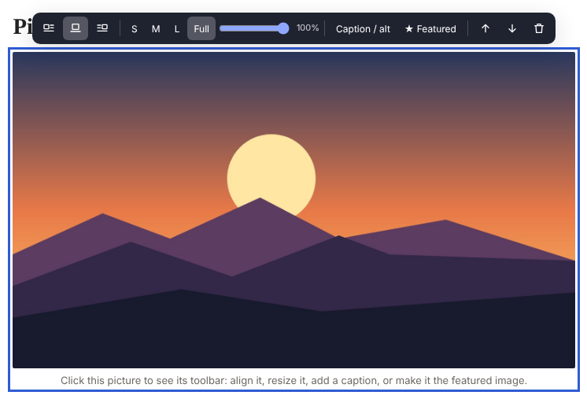
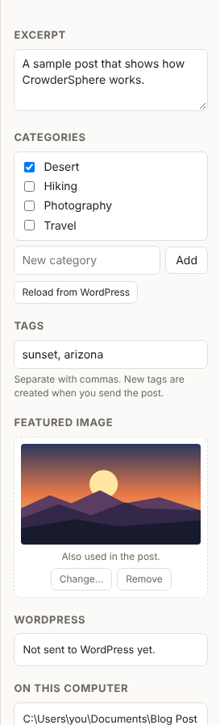
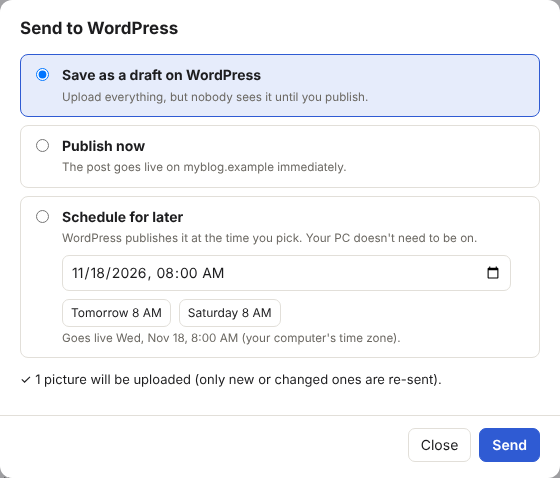

# Getting started with CrowderSphere

CrowderSphere is a desktop app for writing WordPress posts. You write and arrange your posts on your own computer, where they're saved as ordinary folders, and send them to your blog when they're ready.

This guide takes about ten minutes to read. You can also take the one-minute tour inside the app: click **?** at the bottom left and choose **Take the tour**.

- [1. Install](#1-install)
- [2. Your first launch](#2-your-first-launch)
- [3. Connect your blog](#3-connect-your-blog)
- [4. Write a post](#4-write-a-post)
- [5. Add and arrange pictures](#5-add-and-arrange-pictures)
- [6. Add videos](#6-add-videos)
- [7. Categories, tags and the featured image](#7-categories-tags-and-the-featured-image)
- [8. Preview and Export to Word](#8-preview-and-export-to-word)
- [9. Send it to WordPress](#9-send-it-to-wordpress)
- [10. Where your posts are kept](#10-where-your-posts-are-kept)
- [11. Updates](#11-updates)
- [Keyboard shortcuts](#keyboard-shortcuts)
- [Getting help](#getting-help)

---

## 1. Install

Download the installer for your computer from the [latest release](https://github.com/mrdarthdan/crowdersphere/releases/latest):

| Computer | File | Notes |
|---|---|---|
| Windows 10 or 11 | `CrowderSphere_<version>_x64-setup.exe` | Installs just for your account, no admin rights needed. If Windows shows *"Windows protected your PC"*, click **More info → Run anyway**. |
| Mac (Intel or Apple silicon) | `CrowderSphere_<version>_universal.dmg` | Drag CrowderSphere to Applications. The first time, right-click the app and choose **Open**. |
| Linux | `.AppImage`, `.deb` or `.rpm` | The AppImage updates itself; `.deb` and `.rpm` update by installing the newer package. |

## 2. Your first launch

The first time CrowderSphere opens, it shows a short tour and creates a **Welcome to CrowderSphere** post. That post is a sandbox: it explains things as you read it, and nothing in it goes to your blog unless you send it. Try things on it, then delete it with **Delete post** in the panel on the right.



The window has three parts:

- **On the left**, your posts. **+ New post** starts one, and the search box finds older ones. At the bottom are **Folder** (opens the folder your posts are kept in), **Settings**, **?** (help) and the light/dark switch.
- **In the middle**, the post: its title, the toolbar, and the page you write on. At the top are **Preview**, **Export to Word** and **Send to WordPress**.
- **On the right**, the post's settings: excerpt, categories, tags, featured image, its WordPress status and where it's saved. The button at the top right hides or shows this panel.



## 3. Connect your blog

You only need to do this once. Click **Settings** at the bottom left.



1. **WordPress site address:** your blog's address, for example `https://myblog.com`.
2. **WordPress username:** the name you log in to WordPress with.
3. **Application password:** a separate password that lets CrowderSphere post for you. It is *not* your normal login password. To make one:
   1. Log in to WordPress and go to **Users → Profile**.
   2. Scroll to **Application Passwords**, type `CrowderSphere`, and click **Add New Application Password**.
   3. Copy the code it shows (it looks like `abcd efgh ijkl mnop qrst uvwx`) and paste it into CrowderSphere.
4. Click **Save & test connection**. A green check means you're connected.

CrowderSphere keeps the application password in your computer's own password store (Windows Credential Manager, the macOS Keychain, or the Linux keyring), not in a file. To take away CrowderSphere's access at any time, delete the application password in WordPress.

> **Which blogs work?** Self-hosted WordPress 5.6 or newer, and WordPress.com sites on plans that support plugins and application passwords.

## 4. Write a post

Click **+ New post**, type a title at the top, and start writing. There's no save button to remember: your post is saved automatically as you type.

The toolbar, from left to right:

- **Paragraph / Heading** menu: turn a line into a heading (Heading 2, 3, 4), a quote, or code.
- **Font**: change the font of selected text.
- **B, I, U, S**: bold, italic, underline and strikethrough.
- **Lists**: bulleted and numbered.
- **Quote**.
- **Align**: left, center or right.
- **Link** and **Remove link**. **Ctrl+K** also adds a link.
- **Picture** and **Divider line**.
- **Clear formatting**, **Undo** and **Redo**.
- **Spell check** on or off. Right-click a word with a red underline for suggestions.
- **&lt;/&gt;**: shows the post's HTML, for anyone who likes to edit it directly. Click it again to go back.

**Pasting from Word, Google Docs or a web page** keeps headings, bold, italic, lists and links, and drops the clutter: odd fonts, colors and spacing.

The bar at the bottom shows the word count, how many pictures and videos the post has, and roughly how long it takes to read. Select some text to count just that part. The **− 100% +** buttons zoom the page.

## 5. Add and arrange pictures

Add a picture any of these ways:

- the **Picture** button on the toolbar
- drag photos in from your computer
- paste a picture you've copied

Large photos are shrunk to a web-friendly size (1920 pixels wide, which you can change in Settings) and their location data is removed. The originals on your computer aren't changed. Each post keeps its own copies in its `images` folder.

**Click a picture** to show its toolbar:



- **Align**: left, center or right. Text wraps around pictures aligned left or right.
- **Size**: **S**, **M**, **L** or **Full**, or drag the slider for any width.
- **Caption / alt**: the caption shows under the picture. The alt text describes the picture for people using screen readers, and helps search engines.
- **★ Featured**: makes it the post's featured image, the one WordPress shows in post lists and when the post is shared.
- **↑ ↓**: move the picture up or down the post.
- **Delete**: removes the picture from the post. **Delete** on your keyboard does the same, and **Ctrl+Z** brings it back.

Press **Esc** or click in the text to put the picture down.

## 6. Add videos

Click the **Video** button on the toolbar. There are two kinds of video:

- **A YouTube or Vimeo link.** Paste the video's address and click **Add video**. The video stays on YouTube or Vimeo, and WordPress shows its player in your post. Quicker still: paste the link on an empty line and it becomes the video straight away. TikTok and Dailymotion links work too.
- **A video file from your computer** (MP4, MOV or WebM). Click **Choose a video file...**, or drag the file onto the page. CrowderSphere copies it into the post's `videos` folder and makes a still picture from it to show before it plays. The video is uploaded to your WordPress Media Library when you send the post.

Click a video to get the same toolbar as a picture: align, size, caption, move up or down, and delete. In the editor, click the small **Video** label above a video file to select it; clicking the video itself plays it.

**Before you add video files, check two things:**

- **Your site has to accept big files.** WordPress hosts limit how big an upload can be, often 64 to 128 MB on shared hosting, and WordPress.com only allows video uploads on its paid plans. If a video is too big, CrowderSphere says so when you send the post. Ask your host to raise the limit, make the video smaller, or put it on YouTube and add the link instead.
- **Use MP4 (H.264) videos.** iPhones and many Android phones record HEVC (H.265) by default, which a lot of browsers can't play. CrowderSphere warns you when a video is HEVC. On an iPhone, choose **Settings → Camera → Formats → Most Compatible** for new videos. Convert ones you already have with a free app such as HandBrake.

## 7. Categories, tags and the featured image

These are in the panel on the right.



- **Excerpt**: an optional short summary. Some themes show it in post lists.
- **Categories**: tick the ones that fit. Once you're connected, CrowderSphere loads your blog's categories. Add a new one with the box below the list, or click **Reload from WordPress** if you added some on the site.
- **Tags**: type them separated by commas. Tags your blog doesn't have yet are created when you send the post.
- **Featured image**: choose one here, drop a picture onto the box, or click a picture in the post and choose **★ Featured**.

## 8. Preview and Export to Word

- **Preview** shows the post as a clean page, without the editing tools.
- **Export to Word** saves the post as a Word document (`.docx`) in the post's folder, with its pictures, ready to open, proofread or share. Word can't play videos, so each one shows as a line with its link or file name.

## 9. Send it to WordPress

Click **Send to WordPress**.



Choose one:

- **Save as a draft on WordPress**: everything is uploaded, but nobody sees it until you publish it.
- **Publish now**: the post goes live right away.
- **Schedule for later**: pick a date and time. WordPress publishes it then, so your computer doesn't need to be on.

Under the choices, CrowderSphere lists anything you might want to fix first, such as a missing title, category, featured image or alt text, and how many pictures and videos it will upload. Then click **Send**. While a video uploads, the window shows how far along it is.

**Changed something after sending?** Edit the post in CrowderSphere and click **Send to WordPress** again. It updates the same post on your blog rather than making a new one, and only uploads pictures and videos that are new or changed. The **WordPress** box in the panel shows the post's status and a link to it.

## 10. Where your posts are kept

Every post is a folder on your computer, by default inside **Blog Posts** in your Documents folder:

```
Blog Posts/
  2026-11-07-hiking-bryce-canyon/
    post.html     the post itself
    post.json     title, categories, tags and WordPress details
    images/       the post's pictures
    videos/       the post's video files (when it has any)
```

- **Folder** at the bottom left opens this folder. **Show in folder** in the panel opens the current post's own folder.
- To back up your posts, back up this folder. A folder synced with OneDrive, Dropbox or iCloud works well.
- To keep posts somewhere else, change **Folder for posts on this computer** in Settings. Existing posts stay where they are, so move them yourself if you want them in the new place.
- **Delete post** moves the post's folder to the Recycle Bin (the Trash on a Mac), so you can get it back. It doesn't delete anything on your blog.

## 11. Updates

A few seconds after it starts, CrowderSphere checks for a new version. If there is one, it shows you what's new and offers **Update now**. That saves your post, installs the update and reopens CrowderSphere. Your posts and settings are kept.

To turn the automatic check off, or to check by hand, open **Settings → Updates**.

## Keyboard shortcuts

On a Mac, use **Cmd** where this says **Ctrl**.

| Shortcut | What it does |
|---|---|
| **Ctrl+N** | New post |
| **Ctrl+S** | Save now (CrowderSphere also saves automatically) |
| **Ctrl+B / Ctrl+I / Ctrl+U** | Bold / italic / underline |
| **Ctrl+K** | Add or edit a link |
| **Ctrl+Z / Ctrl+Y** | Undo / redo (on a Mac, redo is **Cmd+Shift+Z**) |
| **Ctrl+ + / Ctrl+ − / Ctrl+0** | Zoom in / out / back to 100% (or **Ctrl + mouse wheel**) |
| **Delete** | Remove the selected picture or video |
| **Esc** | Put down the selected picture or video; close a window |

## Getting help

- Click **?** at the bottom left to take the tour again, open this guide, or add a fresh Welcome post to experiment on.
- Found a problem or have an idea? [Open an issue on GitHub](https://github.com/mrdarthdan/crowdersphere/issues). If something went wrong, include the log file:
  - Windows: `%APPDATA%\CrowderSphere\log.txt`
  - Mac: `~/Library/Application Support/CrowderSphere/log.txt`
  - Linux: `~/.config/CrowderSphere/log.txt`
